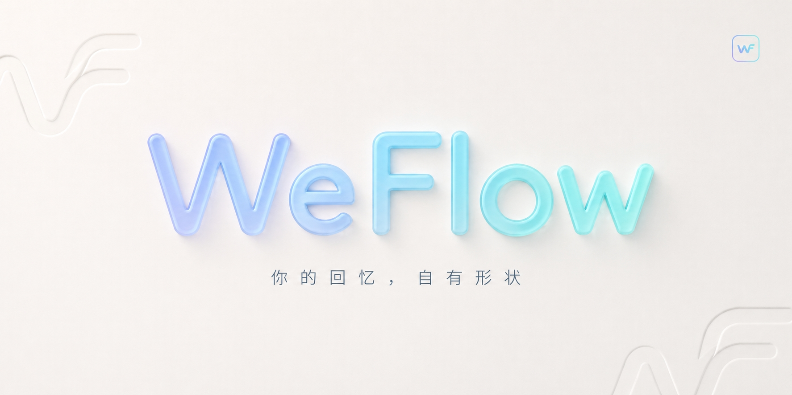

# 消息中枢

Windows 本机聊天记录查询工具，统一微信、企业微信和 QQ 的会话、搜索、媒体、导出与同步界面。双击根目录 `START.cmd` 启动 WebUI；默认地址为 `http://127.0.0.1:8765`。

邮件现支持通用 IMAP、Gmail/Outlook 服务器预设及 EML/MBOX 文件导入，复用统一搜索、会话、导出和 MCP 查询。配置方法及认证边界见 [邮件接入](docs/email.md)。

「中大学生信息站」聚合中山大学公开通知，提供学生资料相关性、搜索分类、收藏已读、院系与服务入口、微信公众号文章链接导入及 MCP 查询。来源覆盖与实际采集边界见 [校园信息源说明](docs/campus-sources.md)。

信息站现为与聊天平台平级的独立入口，提供精选、动态、热点、校园日报、主题、收藏及采集管理，界面和处理流程参考 AIHOT。导航、事件归组与本地规则边界见 [信息站说明](docs/information-station.md)。

需要不依赖本机 Python/Node 的便携版时，按 [Windows 打包说明](docs/windows-package.md) 构建；发布包包含独立 MCP 启动器和经校验的 NapCat/QCE 运行时。

发送能力（QQ、企业微信机器人、个人微信）默认全部关闭，开启后每条消息都要在本机界面逐条审批才会投递；MCP 只能创建待审批请求和查状态，不能审批或发送。

微信和企业微信使用仓库内置的本地读取代码；QQ 随工具提供 NapCat/QCE，复用 QQ Chat Exporter 的历史记录读取链路。QQ 需要本人完成本机登录，服务启动与账号在线是两个不同状态。未连接的数据源不会填充演示记录。

运行说明与第一阶段边界见 [本地工具说明](docs/LOCAL_HUB.md)，代码来源和许可证见 [UPSTREAM.md](UPSTREAM.md)。年度/双人报告、朋友圈和 WeFlow 的其他专属功能尚未移植到统一 WebUI。

以下保留原 WeFlow 文档。它描述原 Electron 应用，其中的外接原生组件要求不适用于上述统一 WebUI 的内置读取链路。

---

<p align="center">
  
</p>

<h1 align="center">WeFlow</h1>

<p align="center">
  WeFlow 是一个<strong>完全本地</strong>的<strong>实时</strong>聊天记录查看、分析与导出工具。<br>
  它可以获取你的聊天记录并将其导出，还可以根据你的聊天记录为你生成独一无二的数据与年度报告。
</p>

<p align="center">
  <a href="https://github.com/hicccc77/WeFlow/stargazers"></a>
  <a href="https://github.com/hicccc77/WeFlow/network/members"></a>
  <a href="https://github.com/hicccc77/WeFlow/releases"></a>
  <br><br>
  <a href="https://t.me/weflow_cc"></a>
  <a href="https://star-history.com/#hicccc77/WeFlow"></a>
</p>

> [!TIP]
> 需要配套的第三方可插拔组件（本项目依赖自定义的原生解密组件，需自行设计，见 [docs/third-party-components.md](docs/third-party-components.md)）


## 主要功能

- 本地实时查看聊天记录
- 朋友圈图片、视频、**实况**的预览和解密
- 统计分析与群聊画像
- 年度报告与可视化概览
- 导出聊天记录为 HTML 等格式
- HTTP API 接口（面向开发者）
- 查看完整能力清单：[详细功能](#详细功能清单)

## 支持平台与设备

| 平台 | 设备/架构 | 安装包 |
|------|----------|--------|
| Windows | Windows10+、x64 | `.exe` |
| macOS | Apple Silicon（M 系列，arm64） | `.dmg` |
| Linux | x64 设备（amd64） | `.AppImage`、`.tar.gz` |


## 详细功能清单

| 功能模块 | 说明 |
|---------|------|
| **聊天** | 解密聊天中的图片、视频、实况；支持**修改**本地消息 |
| **消息防撤回** | 防止其他人发送的消息被撤回 |
| **实时弹窗通知** | 新消息到达时提供桌面弹窗提醒，便于及时查看重要会话，提供黑白名单功能 |
| **私聊分析** | 统计好友间消息数量；分析消息类型与发送比例；查看消息时段分布等 |
| **群聊分析** | 查看群成员详细信息；分析群内发言排行、活跃时段和媒体内容 |
| **年度报告** | 生成按年统计的年度报告，或跨年度的长期历史报告 |
| **双人报告** | 选择指定好友，基于双方聊天记录生成专属分析报告 |
| **消息导出** | 将聊天记录导出为多种格式：JSON、HTML、Markdown、TXT、Excel、CSV、PGSQL、ChatLab专属格式等 |
| **朋友圈** | 解密朋友圈图片、视频、实况；导出朋友圈内容；拦截朋友圈的删除与隐藏操作； |
| **联系人** | 导出好友、群聊、公众号信息；找回部分曾经的好友 |
| **HTTP API 映射** | 将本地消息能力映射为 HTTP API，便于对接外部系统、自动化脚本与二次开发 |

## HTTP API

WeFlow 提供本地 HTTP API 服务，支持通过接口查询消息数据，可用于与其他工具集成或二次开发。

- **启用方式**：设置 → API 服务 → 启动服务
- **默认端口**：5031
- **访问地址**：`http://127.0.0.1:5031`
- **支持格式**：原始 JSON 或 [ChatLab](https://chatlab.fun/) 标准格式

完整接口文档：[点击查看](docs/HTTP-API.md)

## 面向开发者

如果你想从源码构建或为项目贡献代码，请遵循以下步骤：

```bash
# 1. 克隆项目到本地
git clone https://github.com/hicccc77/WeFlow.git
cd WeFlow

# 2. 安装项目依赖
npm install

# 3. 运行应用（开发模式）
npm run dev
```

## 推广与合作

如果您对 **WeFlow** 有兴趣，或者希望与我们展开深度合作或投放你的广告，欢迎随时通过邮件取得联系。我们非常期待与各位创作者、开发者及合作伙伴共同探索。

### 联系方式

欢迎发送邮件至：

<a href="mailto:yccccccy@proton.me"></a>

## 合作伙伴

我们非常欢迎优秀的开源社区项目团队或其他团队与我们建立长期合作关系。期待与 WeFlow 携手并进，共同建设更开放的生态！

<p align="center">
  <!-- 是的你没看错这里还是占位！
  <a href="https://your-partner-website.com" target="_blank">
    
  </a> -->
</p>

---

## 贡献者

感谢所有做出贡献的开发者！

<p align="center">
  <a href="https://github.com/hicccc77/WeFlow/graphs/contributors">
    
  </a>
</p>

## Star History

<a href="https://www.star-history.com/#hicccc77/WeFlow&type=date&legend=top-left">
  <picture>
    <source media="(prefers-color-scheme: dark)" srcset="https://api.star-history.com/svg?repos=hicccc77/WeFlow&type=date&theme=dark&legend=top-left" />
    <source media="(prefers-color-scheme: light)" srcset="https://api.star-history.com/svg?repos=hicccc77/WeFlow&type=date&legend=top-left" />
    
  </picture>
</a>

<div align="center">

---

**请负责任地使用本工具，遵守相关法律法规**

</div>
